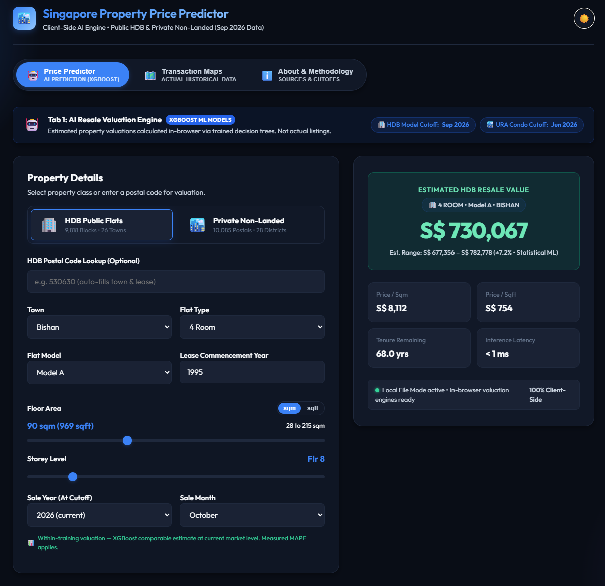
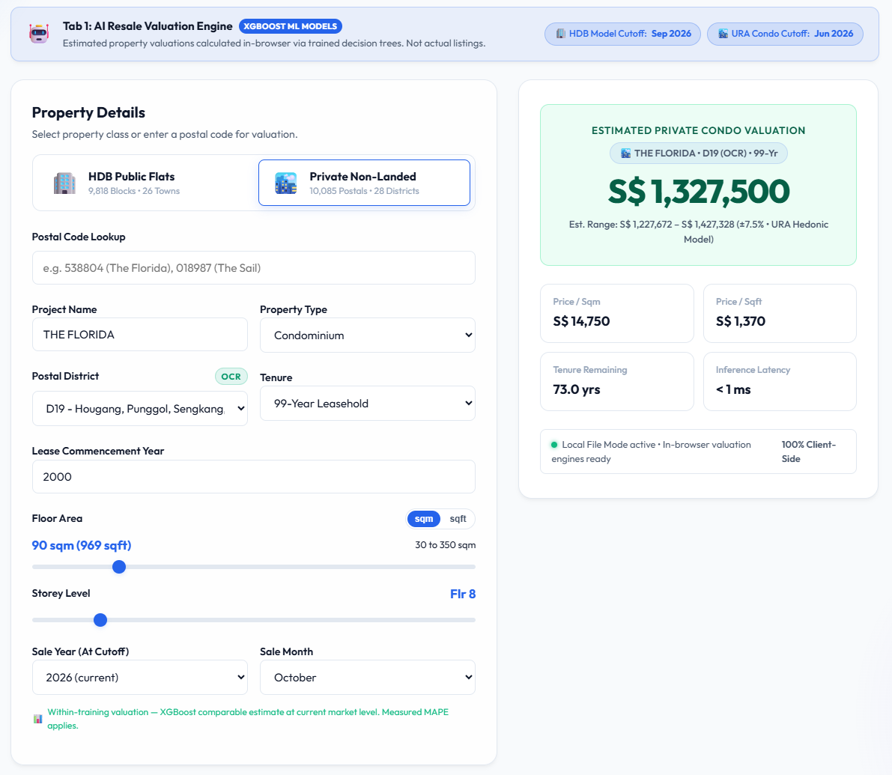
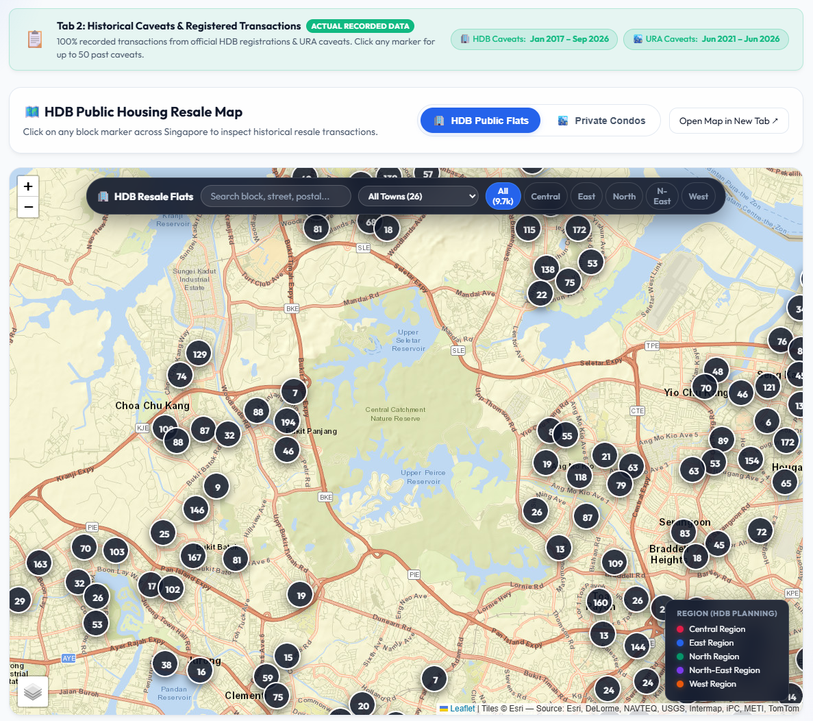
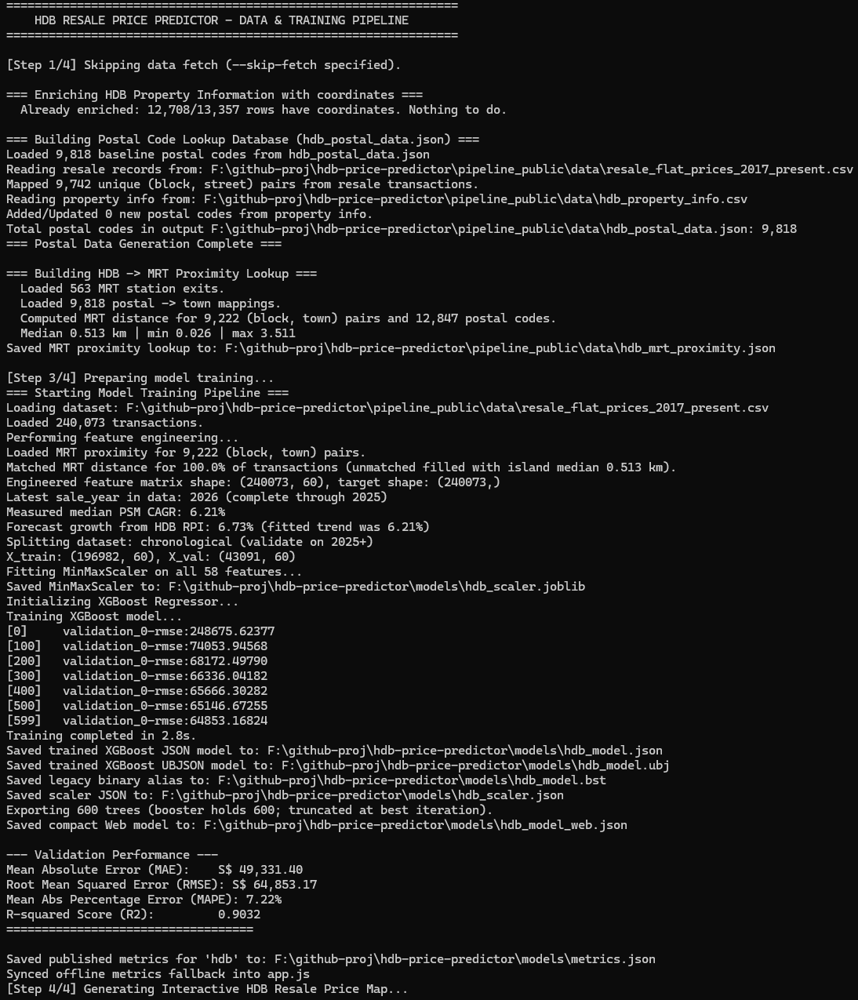

# 🏙️ HDB Resale Price Predictor

An in-browser AI engine and automated machine learning pipeline for estimating Singapore Housing & Development Board (HDB) resale flat prices.

Powered by client-side **XGBoost tree traversal (< 1ms latency)**, this application runs entirely inside the user's browser with **zero server cold starts**, zero hosting costs, and offline capability.

Live Deployment:
- **Static Web App (GitHub Pages)**: `https://seehiong.github.io/hdb-price-predictor/`



---

## 🎯 Why this project?

Most property-valuation demos stop at a prediction API. This one explores whether a genuinely useful valuation engine can be packaged **entirely into a static web application** — the model, the feature preprocessing, the postal lookups, the transaction maps and the valuation logic all run locally in the browser, with no server, no API keys and no cold starts.

That constraint drives most of the design: models are exported as compact JSON tree structures, the scaler is inlined, and inference is a hand-written Float32Array tree walk. The second theme is **honest measurement** — the models are validated on future sales rather than a shuffled split, and the published accuracy figures are generated by the training run itself so they cannot drift from what actually ships.

## 🧭 How it works

```
┌────────────────────────────────────────────────┐
│  Official Singapore open data                  │
│  HDB resale · URA caveats · BCA MCST           │
│  MRT exits · HDB RPI · URA PPI (CCR/RCR/OCR)   │
└──────────────────────┬─────────────────────────┘
                       │  01_fetch_data
                       ▼
┌────────────────────────────────────────────────┐
│  ETL + feature engineering                     │
│  postal lookups · MRT proximity · encodings    │
└──────────────────────┬─────────────────────────┘
                       │  02_build_* 
                       ▼
┌────────────────────────────────────────────────┐
│  XGBoost training                              │
│  chronological holdout — validated on the      │
│  most recent complete year, never shuffled     │
└──────────────────────┬─────────────────────────┘
                       │  03_train_model
                       ▼
┌────────────────────────────────────────────────┐
│  Browser export                                │
│  compact tree JSON · scaler · metrics.json     │
└──────────────────────┬─────────────────────────┘
                       │  04_build_map
                       ▼
┌────────────────────────────────────────────────┐
│  Static web app on GitHub Pages                │
│  client-side inference · < 1 ms · offline      │
└────────────────────────────────────────────────┘
```

---

## ✨ Features

- **⚡ Client-Side Machine Learning**:
  - Direct in-browser evaluation of 600 XGBoost decision trees in pure JavaScript (~0.2ms).
  - Real-time reactive price recalculation as you drag sliders or change dropdowns.
  - Zero server dependencies, zero cold-start delays, and offline-capable.
- **📮 Instant Postal Code Auto-Fill**:
  - Automatically retrieves town and lease commencement year from a catalog of **9,818 Singapore postal codes**.
- **🗺️ Integrated Transaction Maps**:
  - Embedded Leaflet/OpenStreetMap transaction maps showing up to the last 50 real resale transactions for both **9,818 HDB postal codes** and **2,431 private non-landed developments** across Singapore without external API keys.
- **📊 Valuation Range & Breakdown**:
  - Provides an estimated resale price with an **indicative valuation range** derived from the model's forward-looking validation MAPE (read live from `models/metrics.json`). This is a typical-error band, not a statistical confidence interval.
  - Computes Price per Sqm, Price per Sqft, and Remaining Lease at expected sale date.
- **🎨 Modern Responsive UI**:
  - Dark and Light mode options with state persistence.
  - Glassmorphic card design optimized for mobile and desktop screens.
- **🔄 Automated Python ETL & Training Pipeline**:
  - Standalone, self-contained pipeline that fetches live transactions directly from Data.gov.sg API and retrains the model in seconds.

---

## 📸 Screenshots

<table>
<tr>
<td width="50%"><br><sub><b>Main valuation screen</b> — instant in-browser XGBoost estimate with indicative price range, PSM/PSF metrics and inference latency.</sub></td>
<td width="50%"><br><sub><b>Two markets, one engine</b> — public HDB and private non-landed valuation, each backed by its own independently trained model.</sub></td>
</tr>
<tr>
<td width="50%"><br><sub><b>Transaction maps</b> — up to 50 recent resale transactions per block or development, on Leaflet/OpenStreetMap with no API keys.</sub></td>
<td width="50%"><br><sub><b>Reproducible retraining</b> — one command fetches data, rebuilds features, validates chronologically and exports the browser model.</sub></td>
</tr>
</table>

---

## 📊 Model Performance & Independent Benchmarks

The application maintains **two distinct, independently trained XGBoost models** evaluated on unseen holdout validation splits.

### Two prediction modes

The year picker runs from 2017 (the start of the HDB training dataset) through 2032. Selecting a date automatically determines which engine path is used, and the label and hint text update in the UI to make this explicit based on the active model's training cutoff (`latest_complete_year = 2025`).

| | **Historical / Comparable Valuation** | **Index-Adjusted Forward Projection** |
| :--- | :--- | :--- |
| **Question** | What did this property trade for in a past year, or what is it worth within the training window? | What might it be worth at a future date beyond the training cutoff? |
| **Sale date** | Within the training range (≤ model cutoff year, e.g. ≤ 2025) | Beyond the training cutoff (> model cutoff year, e.g. 2026+) |
| **Produced by** | XGBoost, directly, at the historical year and month selected (`growthFactor = 1.0`) | XGBoost at the training endpoint (2025, mid-year month), scaled by an official market index |
| **Error is** | *Measured* — holdout MAPE on held-out future sales (**4.63% HDB / 6.27% Condo**) | *Not measured* — inherits base valuation error, plus whatever the index assumption deviates |
| **Fails when** | The property type was rare or market was unusual in that period | The macroeconomic trend pivots and the historical index trend does not |
| **UI label** | `Sale Year (Historical)` · green hint | `Target Sale Year (Forecast)` · default hint |

The XGBoost model itself never forecasts. It cannot: gradient-boosted trees partition the feature space, so any `sale_year` past the training range lands in the same terminal leaf and returns the last level it saw. Everything time-dependent beyond the cutoff comes from the published index, applied as an explicit multiplier — which is why the app labels a projected estimate with the rate and horizon it assumed rather than presenting it as a measurement. For dates within the training window (`sale_year <= cutoff`), `growthFactor` is exactly `1.0` and no index is applied.

The two models:

### 1. 🏢 Public (HDB) Resale Model (600 Trees)
* **Dataset**: 240,345 official resale registrations (HDB via Data.gov.sg, Jan 2017 – Dec 2025 training with 2026+ holdout validation)
* **Mapped Catalog**: 9,818 HDB postal codes (block → town → lease commence year) across all 26 towns

| Metric | Score |
| :--- | :--- |
| **Model Architecture** | XGBoost Regressor (max depth 8, early stopping; 599 trees kept) |
| **Engineered Features** | 60 spatial, temporal, flat and MRT-proximity characteristics |
| **Mean Absolute Percentage Error (MAPE)** | **4.63%** across 18,278 held-out future sales |
| **Mean Absolute Error (MAE)** | **S$ 31,089.56** |
| **R² Score (Validation)** | **0.9553** (explains 95.5% of HDB price variance) |
| **Root Mean Squared Error (RMSE)** | **S$ 45,074.60** |
| **Validation Split** | chronological (validate on 2026+ holdout) |
| **Forecast Index** | HDB Resale Price Index (1Q2009=100), quarterly |
| **Client-Side Inference Time** | **< 1 millisecond** (Float32Array tree traversal in pure JS) |

### 2. 🏙️ Private (Non-Landed) Model — Condo, Apartment, EC (77 Trees)
* **Dataset**: 71,538 non-landed records, filtered from 83,848 curated URA resale caveats (URA Data Service via Ryeo, Jun 2021 – Dec 2025 training with 2026+ holdout validation). The 12,310 excluded rows are landed property (terrace, semi-detached, detached and their strata variants), which this model does not cover.
* **Mapped Catalog**: 10,085 postal codes across 2,431 developments in CCR, RCR, and OCR

| Metric | Score |
| :--- | :--- |
| **Model Architecture** | XGBoost Regressor (max depth 8, early stopping; 77 trees kept) |
| **Engineered Features** | 45 features (project & street price encoding across 2,204 developments, floor area, floor level, tenure, remaining lease, district) |
| **Mean Absolute Percentage Error (MAPE)** | **6.27%** across 5,458 held-out future sales |
| **Mean Absolute Error (MAE)** | **S$ 136,553.20** |
| **R² Score (Validation)** | **0.9597** (explains 96.0% of private non-landed price variance) |
| **Root Mean Squared Error (RMSE)** | **S$ 269,177.82** |
| **Validation Split** | chronological (validate on 2026+ holdout) |
| **Forecast Index** | URA Property Price Index of Non-landed Properties by Locality (CCR/RCR/OCR), quarterly |
| **Client-Side Inference Time** | **< 1 millisecond** (Float32Array tree traversal in pure JS) |

> These are **model-level validation metrics**, not a guarantee that any individual property will be valued within the stated range. MAPE is listed first because it answers the question a reader actually has — how far off is a typical estimate — more directly than R².
>
> Both models are scored on a **chronological holdout**: trained on all complete calendar years (through 2025), and scored on subsequent unseen future sales (2026+). A shuffled split lets the model see later sales of the same block or project and roughly halves the apparent error, so these figures are deliberately less flattering and more honest.
>
> Accuracy figures are generated by the training run into `models/metrics.json` and read by the page at load, so they cannot drift from the model that actually ships.

📘 **[docs/methodology.md](docs/methodology.md)** covers the rest: why chronological validation, how forward projection works, why the training target is *not* deflated by the index, and which approaches were measured and rejected.

---

## 📁 Project Structure

```bash
.
├── index.html                           # Static web application (GitHub Pages)
├── styles.css                           # Modern responsive styling & dark/light theme
├── app.js                               # Dual-mode client-side inference engine
│
├── models/                              # Trained Machine Learning Model Artifacts
│   ├── hdb_model.bst                    # Public HDB XGBoost binary model
│   ├── hdb_model.json                   # Public HDB XGBoost JSON model
│   ├── hdb_model.ubj                    # Public HDB XGBoost Universal Binary model
│   ├── hdb_model_web.json               # Compact in-browser decision trees (600 trees)
│   ├── hdb_scaler.joblib                # Fitted MinMaxScaler for Python
│   ├── hdb_scaler.json                  # Scaler vectors for browser inference
│   ├── condo_model.bst                  # Private (non-landed) XGBoost binary model
│   ├── condo_model.json                 # Private (non-landed) XGBoost JSON model
│   ├── condo_model.ubj                  # Private (non-landed) XGBoost UBJ model
│   ├── condo_model_web.json             # Compact in-browser decision trees (181 trees)
│   ├── condo_scaler.joblib              # Fitted MinMaxScaler for Python
│   ├── condo_scaler.json                # Scaler vectors for browser inference
│   └── condo_features.txt               # Feature schema for the private (non-landed) model
│
├── pyproject.toml                       # uv package and dependency configuration
├── uv.lock                              # Pinned dependency lockfile
├── requirements.txt                     # Pip requirements for Python ETL and training
├── pipeline_public/                          # Public HDB ETL and training pipeline
│   ├── data/
│   │   └── hdb_postal_data.json              # 9,818 HDB postal codes & lease lookup database
│   │   └── .onemap_postal_cache.json         # OneMap postal -> street/coords (HDB only)
│   ├── 01_fetch_data.py                      # Resale txns + HDB Resale Price Index (smart caching)
│   ├── 02_build_postal_data.py               # Postal database generator
│   ├── 02b_build_mrt_proximity.py            # HDB block -> nearest MRT exit distances
│   ├── 02c_enrich_property_info.py           # Adds postal codes & coordinates to property table
│   ├── 03_train_model.py                     # Feature engineering, scaling & XGBoost training
│   ├── 04_build_map.js                       # Generator for interactive HDB resale map (~7.7 MB)
│   ├── hdb_resale_price_map_clickable.html   # Interactive Leaflet map for HDB (9.7k blocks)
│   ├── DATA_DICTIONARY.md                    # Column definitions for public datasets
│   ├── run_pipeline.py                       # One-click pipeline orchestrator
│   └── README.md                             # Public pipeline documentation
├── pipeline_private/                         # Private Housing & Condo ETL and training pipeline
│   ├── data/
│   │   ├── private_nonlanded_postal_data.json # 2,431 non-landed developments (condo, apt, EC)
│   │   ├── bca_mcst_registry.json            # 3,682 BCA Management Corporation Strata Title records
│   │   └── private_resi_transactions.csv     # 83,848 curated URA caveats; 71,538 non-landed used for training
│   ├── 01_fetch_data.py                      # URA caveats + BCA MCST + URA PPI (CCR/RCR/OCR)
│   ├── 01b_extract_kaggle_data.py            # URA resale extractor from Kaggle dataset
│   ├── 01c_merge_historical_data.py          # Merges a historical export, deduplicating the overlap
│   ├── 02_build_postal_data.py               # Dwelling units & road abbreviation resolver
│   ├── 03_train_model.py                     # Tenure, floor & district feature training
│   ├── 04_build_map.js                       # Generator for private non-landed resale map
│   ├── condo_resale_price_map_clickable.html # Interactive Leaflet map for Condos (2.4k projects)
│   ├── run_pipeline.py                       # One-click private pipeline orchestrator
│   └── README.md                             # Private pipeline documentation
├── docs/
│   ├── images/                               # README screenshots (placeholders until captured)
│   └── methodology.md                        # Validation, forecasting & rejected approaches
└── README.md
```

---

## 📚 Data Sources & Attribution

This project utilizes open public datasets released under permissive open data licenses:

1. **HDB Resale Flat Prices Dataset**:
   * **Source**: Data.gov.sg dataset [`d_8b84c4ee58e3cfc0ece0d773c8ca6abc`](https://data.gov.sg/datasets/d_8b84c4ee58e3cfc0ece0d773c8ca6abc/view) — Housing & Development Board.
   * **License**: [Singapore Open Data Licence](https://data.gov.sg/open-data-licence)
   * **Coverage**: Official historical resale registrations from January 2017 onwards (~240,000 transactions).

2. **URA Private Residential Resale Caveats**:
   * **Primary Source**: Urban Redevelopment Authority (URA) Real Estate Data Service / Caveats API (`PMI_Resi_Transaction`).
   * **Curated Distribution**: [Singapore Property Transactions (HDB & Private)](https://www.kaggle.com/datasets/y2h1987/singapore-property-transactions-hdb-private/data) by **Ryeo** on Kaggle.
   * **License**: [Creative Commons Attribution 4.0 International (CC BY 4.0)](https://creativecommons.org/licenses/by/4.0/).
   * **Coverage**: 83,848 verified private residential resale caveat transactions (2021–2026) across all 28 Singapore postal districts and CCR, RCR, OCR regions.

3. **Market Price Indices** (used to project prices past the training cutoff; downloaded by the **fetch stage** and cached in `models/`, so training itself needs no network):
   * **HDB Resale Price Index (1Q2009 = 100), Quarterly**: Data.gov.sg dataset [`d_14f63e595975691e7c24a27ae4c07c79`](https://data.gov.sg/datasets/d_14f63e595975691e7c24a27ae4c07c79/view) — HDB, 1990-Q1 onwards.
   * **Property Price Index of Non-landed Properties by Locality, Quarterly**: Data.gov.sg dataset [`d_f65e490a8ad430f60a9a3d9df2bff2a0`](https://data.gov.sg/datasets/d_f65e490a8ad430f60a9a3d9df2bff2a0/view) — URA, split by CCR / RCR / OCR, 2004-Q1 onwards.

4. **HDB Property Information**:
   * **Source**: Data.gov.sg dataset [`d_17f5382f26140b1fdae0ba2ef6239d2f`](https://data.gov.sg/datasets/d_17f5382f26140b1fdae0ba2ef6239d2f/view) — Housing & Development Board.
   * **Coverage**: 13,357 blocks with storey count, year completed and dwelling-unit mix. Published without any location, so `02c_enrich_property_info.py` derives postal codes and coordinates from the building footprints below.

5. **Geospatial & Building Master Data** (GeoJSON file downloads, ~57 MB; fetched by each pipeline's **fetch stage** into its own `data/` directory):
   * **URA Number of Dwelling Units** *(private pipeline)*: Data.gov.sg dataset [`d_be71daeab5930f96b90ad2857454d876`](https://data.gov.sg/datasets/d_be71daeab5930f96b90ad2857454d876/view) — 83,541 developments with postal code and project name; fetched by `pipeline_private/01_fetch_data.py` and used to build the condo postal lookup.
   * **LTA MRT Station Exits** *(public pipeline)*: Data.gov.sg dataset [`d_b39d3a0871985372d7e1637193335da5`](https://data.gov.sg/datasets/d_b39d3a0871985372d7e1637193335da5/view) — 613 station exits; each HDB block's distance to the nearest one becomes a model feature.
   * **HDB Existing Building Footprints** *(public pipeline)*: Data.gov.sg dataset [`d_16b157c52ed637edd6ba1232e026258d`](https://data.gov.sg/datasets/d_16b157c52ed637edd6ba1232e026258d/view) — 13,436 building polygons carrying block number and postal code; the source of the coordinates `02c_enrich_property_info.py` attaches to the property table.
   * **OneMap** ([Singapore Land Authority](https://www.onemap.gov.sg/apidocs/)): `/common/elastic/search` resolves a postal code to its authoritative block, street and coordinates — the only source here that can tell one "block 32" from another. **No API key or token required** for this endpoint; results are cached in `pipeline_public/data/.onemap_postal_cache.json` so it is a one-time cost.

6. **BCA Management Corporation Strata Title (MCST) Information**:
   * **Source**: Data.gov.sg dataset [`d_f988c57e16e99ad3a649aa04572efd1c`](https://data.gov.sg/datasets/d_f988c57e16e99ad3a649aa04572efd1c/view) — Building and Construction Authority (BCA).
   * **License**: [Singapore Open Data Licence](https://data.gov.sg/open-data-licence)
   * **Coverage**: Official register of 3,682 Management Corporation Strata Title (MCST) schemes across Singapore, including official MCST Plan registration numbers, constitution dates (1970s–present), development names, and postal codes.
   * **Usage**: Fetched by `pipeline_private/01_fetch_data.py` (`ensure_bca_mcst_registry`), compiled to `pipeline_private/data/bca_mcst_registry.json`, and consumed by `pipeline_private/04_build_map.js` to enrich condo map popups with verified strata registration numbers and constitution dates, while clearly distinguishing strata-titled developments from single-owner non-strata rental properties (e.g. *Royal Palm Mansions*).


## 🚀 Quick Start

### 1. Environment Setup with `uv`

We recommend using [`uv`](https://docs.astral.sh/uv/) for fast, isolated Python dependency management:

```bash
# Sync dependencies into local .venv
uv sync
```

*(Alternatively with standard `pip`: `python -m venv .venv && source .venv/bin/activate && pip install -r requirements.txt`)*

---

### 2. Previewing the Static Web App Locally

Run a lightweight static HTTP server in the repository root:

```bash
uv run python -m http.server 8000
```
Then open [http://localhost:8000](http://localhost:8000) in your browser.

---

### 3. What ships in the repository

A fresh clone runs the web app immediately — the trained models, scalers, postal lookups and MRT distances are all committed, so `index.html` works with no build step.

The raw datasets are not committed, because they are large and are re-downloadable from the source:

| | Committed | Fetched by `01_fetch_data.py` | Notes |
| :--- | :---: | :---: | :--- |
| Trained models + scalers | ✅ | — | App works straight from a clone |
| `hdb_postal_data.json`, MRT distances | ✅ | — | Rebuilt only if source geodata is present |
| `private_resi_transactions.csv` | ✅ | — | 10 MB; private pipeline retrains offline |
| `bca_mcst_registry.json` | ✅ | ✅ | 410 KB; BCA strata title registry & constitution years |
| HDB resale transactions (~40 MB) | ❌ | ✅ | Required to retrain the HDB model |
| `hdb_property_info.csv` | ❌ | ✅ | Block metadata |
| HDB RPI / URA PPI indices | ❌ | ✅ | Cached under `models/` |

So on a clean clone:

```bash
# works with no downloads
python -m http.server 8000                     # then open http://localhost:8000
uv run python pipeline_private/run_pipeline.py --skip-fetch

# needs one download first (~40 MB, a few minutes)
uv run python pipeline_public/run_pipeline.py
```

Running the public pipeline with `--skip-fetch` on a clone that has never fetched will fail with a message naming the file and the command to get it.

**Building footprints.** The published property dataset carries no location — no postal code, no coordinates — so `02c_enrich_property_info.py` derives both from HDB building footprints and appends them (24 columns in, 34 out). That is what lets the map plot one pin per block and the MRT stage key distances by postal code.

**No API keys are required.** Every source this project reads is open: Data.gov.sg datasets download without authentication, and the OneMap endpoint used to resolve postal codes to street names (`/common/elastic/search`) is public. OneMap does require a token for some of its other endpoints, but none of those are used here, so a clone needs no accounts, keys or environment variables.

**Regenerating the committed lookups is not recommended.** `hdb_postal_data.json` was built with an address-resolution step that is not part of this repository. Rerunning the pipeline rebuilds it from building footprints instead, which produces a larger but slightly less accurate file — block numbers repeat across towns (block 328 exists in twelve), so inferring a block's town from footprints alone gets some of them wrong. Measured: MRT match falls from 100% to 98.5% and HDB MAPE rises by ~0.10 percentage points. The note at the top of `02c_enrich_property_info.py` has the detail.

The pipeline is safe to rerun for models. If it overwrites those two lookups, restore them with `git checkout pipeline_public/data/` before committing.

**Nothing in `pipeline_*/data/` needs to be placed there by hand.** Every input the pipelines read is downloaded from Data.gov.sg by the fetch stage; the committed files are small derived lookups so the web app works before anything is run. If a working copy of this repository contains other datasets, they are leftovers from exploration rather than pipeline inputs — the pipelines read only the files listed above.

It needs two GeoJSON layers, together about 57 MB. They are too large to commit but `01_fetch_data.py` downloads them into `pipeline_public/data/`, so a clone needs no manual setup:

| File | Data.gov.sg dataset |
| :--- | :--- |
| `HDBExistingBuilding.geojson` | `d_16b157c52ed637edd6ba1232e026258d` |
| `LTAMRTStationExitGEOJSON.geojson` | `d_b39d3a0871985372d7e1637193335da5` |

If the download fails — the endpoint is occasionally rate-limited — both stages skip with a message and the committed lookups are used instead, so training and the web app still work; only rebuilding the map and the MRT distances from scratch needs them.

---

### 4. Updating Data & Retraining Models

#### Public HDB Pipeline
```bash
# Complete end-to-end HDB pipeline:
uv run python pipeline_public/run_pipeline.py

# Re-train using already downloaded data:
uv run python pipeline_public/run_pipeline.py --skip-fetch
```

#### Private (Non-Landed) Pipeline
```bash
# Complete end-to-end private non-landed pipeline:
uv run python pipeline_private/run_pipeline.py

# Re-train using cached transactions:
uv run python pipeline_private/run_pipeline.py --skip-fetch
```

---

## ⚠️ Limitations

- **This is an indicative valuation tool, not a professional property valuation.** It has no standing for financing, taxation or legal purposes.
- **Estimates reflect transacted prices, not asking prices.** Both datasets are records of completed sales, so an estimate will lag a fast-moving market and will not match listing prices.
- **The model cannot see the things that make one unit differ from its neighbour** — renovation quality, interior condition, view, facing, noise, floor plan efficiency or en-bloc potential are all absent from the source data.
- **Forward estimates add an un-measured assumption on top of the model error.** Dates beyond the training cutoff are scaled by a published market index and assume the property tracks its segment. Historical and at-cutoff dates (within the training range) use pure XGBoost with no index applied — the measured MAPE applies directly. The UI labels which mode is active. See the two-modes table above.
- **The stated error is a model-level average, not a per-property guarantee.** A 4.63% MAPE describes typical error across 18,278 held-out future sales for HDB (and 6.27% across 5,458 sales for condos) — any individual estimate can be further off, particularly for unusual properties.
- **Coverage is bounded by the source datasets.** Private-property coverage depends on URA caveats over a five-year window, so districts with little resale activity are thinly represented — District 24 has no transactions at all and falls back to a neighbouring district. Landed property is excluded entirely.
- **MRT proximity is straight-line distance to the nearest exit**, joined on block and town. Around 7% of transactions share a block key with another building and carry an averaged distance (documented in `02b_build_mrt_proximity.py`).
- **Historical validation does not guarantee future accuracy.** Policy changes — cooling measures, loan limits, BTO supply — can shift the market in ways no amount of past data anticipates.

---

## 🔗 Related Projects

Part of the Singapore PropTech AI open-source ecosystem:
- [Autonomous HDB DeepAgents](https://github.com/seehiong/autonomous-hdb-deepagents): Multi-agent geospatial and resale intelligence using LangGraph and MCP tools.
- [SmartFlat AI](https://github.com/seehiong/smartflat-ai): Multi-agent property advisor built with AWS Bedrock AgentCore.